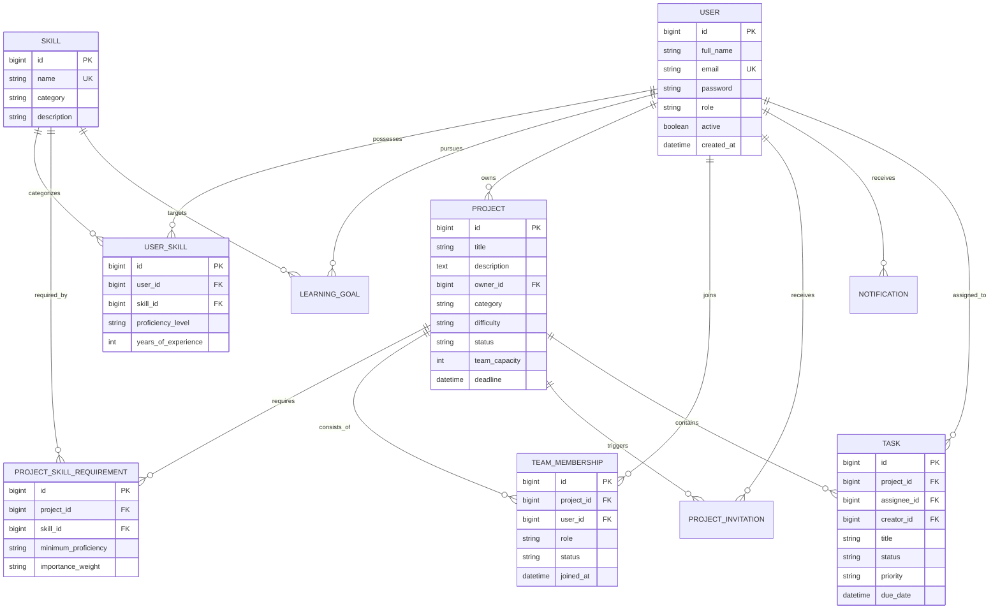

# SkillBridge — Student Skill, Project and Collaboration Platform

[](https://spring.io/projects/spring-boot)
[](https://reactjs.org/)
[](https://vitejs.dev/)
[](https://www.mysql.com/)
[](LICENSE)

SkillBridge is a full-stack, enterprise-grade academic collaboration platform designed to empower students to analyze technical capabilities, create verified skill profiles, discover suitable projects, compute deterministic skill gaps, find teammates with complementary skills, manage team tasks, and achieve targeted learning goals.

---

## 🌟 Key Features

1. **Secure Stateless Authentication & Authorization**
   - User registration and login backed by BCrypt password encryption and stateless JSON Web Tokens (JJWT 0.12.6).
   - Role-Based Access Control (`ROLE_STUDENT`, `ROLE_ADMIN`) enforced via Spring Security `@PreAuthorize`.
   - Ownership guards ensuring students only manipulate their personal skills, goals, and owned projects.

2. **Skill Profiles & Catalog**
   - Curated taxonomy of engineering disciplines (Languages, Frameworks, Cloud, Databases, DevOps).
   - Proficiency tracking (`BEGINNER`, `INTERMEDIATE`, `ADVANCED`) with live profile completeness calculations.

3. **Project Management & Collaboration**
   - Complete project lifecycle (`OPEN`, `IN_PROGRESS`, `COMPLETED`, `ARCHIVED`).
   - Granular skill requirement definitions with proficiency levels and importance weights (`LOW`, `MEDIUM`, `HIGH`).
   - Team capacity limits, owner roles, member permissions, and project progress derived directly from task completion.

4. **Deterministic & Explainable Skill-Matching Algorithm**
   - 100% transparent and explainable weighted coverage calculation:
     $$\text{Coverage \%} = 100 \times \frac{\sum \text{Earned Weights of Satisfied Requirements}}{\sum \text{Total Requirement Weights}}$$
   - Evaluates full matches, partial proficiency matches (50% weight credit), and missing skills without unpredictable AI models.

5. **Actionable Skill-Gap Analysis**
   - Instant diagnostic comparison between a student's stored skills and any project's requirements.
   - Categorizes gaps by severity and generates actionable, step-by-step remediation objectives.
   - One-click transformation of skill recommendations into persistent student learning goals.

6. **Complementary Teammate Discovery & Invitations**
   - Identifies candidate students possessing skills required by a project that are currently missing from the existing team.
   - Safe invitation state machine (`PENDING`, `ACCEPTED`, `REJECTED`) with capacity validation and transaction boundaries.

7. **Project Task Management & Progress**
   - Kanban-ready task management (`TODO`, `IN_PROGRESS`, `COMPLETED`) with assignee restrictions to authorized team members.
   - Live project completion percentages calculated from completed tasks.

8. **Notifications & Platform Administration**
   - Private notifications for invitations, team updates, and task assignments.
   - Admin console with platform metrics, user status toggling, role management, and project moderation.

9. **Interactive API Documentation**
   - Built-in Swagger/OpenAPI documentation with live request execution at `/swagger-ui/index.html`.

---

## 🏗️ Architecture & Folder Structure

```
SkillBridgeApp/
├── backend/                       # Spring Boot 3.3.4 Application (Java 17/25)
│   ├── src/
│   │   ├── main/
│   │   │   ├── java/com/skillbridge/
│   │   │   │   ├── config/        # Security, JWT filters, OpenAPI, DataInitializer
│   │   │   │   ├── controller/    # 13 REST Controllers
│   │   │   │   ├── dto/           # Request and Response DTOs
│   │   │   │   ├── entity/        # 10 JPA Entities & Enums
│   │   │   │   ├── exception/     # GlobalExceptionHandler & Custom Exceptions
│   │   │   │   ├── repository/    # Spring Data JPA Repositories
│   │   │   │   ├── security/      # UserDetails & Custom Services
│   │   │   │   └── service/       # Business Logic & SkillMatchService
│   │   │   └── resources/
│   │   │       └── application.properties
│   │   └── test/java/com/skillbridge/ # JUnit 5 & Mockito Unit/Integration Tests
│   ├── Dockerfile                 # Multi-stage production container build
│   ├── pom.xml                    # Maven configuration and dependencies
│   └── .env.example               # Backend environment template
├── frontend/                      # React 19.2 + Vite 8.3 Application
│   ├── src/
│   │   ├── assets/                # Static assets and icons
│   │   ├── components/            # Reusable UI components (Navbar, Sidebar, Modal, Badge, EmptyState)
│   │   ├── context/               # AuthContext with JWT session management
│   │   ├── pages/                 # 15 SaaS application pages
│   │   ├── services/              # Centralized Axios API service layer
│   │   ├── App.jsx                # Application routing and authenticated layout
│   │   ├── index.css              # Custom CSS design system (tokens, SaaS styling)
│   │   └── main.jsx
│   ├── package.json
│   ├── vite.config.js
│   ├── .env                       # Vite environment configuration
│   └── .env.example
├── docker-compose.yml             # Orchestration for MySQL and Backend
├── .gitignore                     # Git exclusions
├── .env.example                   # Root environment configuration template
└── README.md
```

---

## 📊 Database Entity-Relationship Diagram



---

## 🛠️ Technology Stack

| Layer | Technologies |
| :--- | :--- |
| **Frontend** | React 19, Vite 8, React Router v7, Axios, Lucide React, Custom CSS Design System |
| **Backend** | Java 17/25, Spring Boot 3.3.4, Spring Data JPA, Spring Security, JJWT 0.12.6, Hibernate 6.5 |
| **Database** | MySQL 8.0 (ACID compliant, InnoDB engine) |
| **Testing** | JUnit 5, Mockito, Spring Boot Test, Vite Build Validation |
| **API Docs** | SpringDoc OpenAPI 2.6.0 (Swagger UI) |
| **DevOps** | Docker, Docker Compose, Multi-stage Dockerfile |

---

## 🚀 Getting Started

### Prerequisites
- **JDK**: Java 17 or higher (JDK 17, 21, or 25).
- **Maven**: Version 3.8+ (`mvn -version`).
- **Node.js**: Version 18+ and `npm`.
- **MySQL**: MySQL Server 8.0 running locally on port `3306` (or Docker).

---

### Step 1: Database Setup
Connect to MySQL and create the database:
```sql
CREATE DATABASE IF NOT EXISTS skillbridge_db CHARACTER SET utf8mb4 COLLATE utf8mb4_unicode_ci;
```

---

### Step 2: Backend Configuration & Startup

1. Open `backend/src/main/resources/application.properties` (or configure environment variables):
   ```properties
   DB_HOST=127.0.0.1
   DB_PORT=3306
   DB_NAME=skillbridge_db
   DB_USERNAME=root
   DB_PASSWORD=root
   ```

2. Run automated backend tests:
   ```powershell
   cd backend
   mvn test
   ```

3. Launch the Spring Boot backend:
   ```powershell
   mvn spring-boot:run
   ```
   *The server starts on `http://localhost:8080`. On initial boot, `DataInitializer` seeds 18 default skills, demo student accounts, demo projects, tasks, and sample learning goals.*

---

### Step 3: Frontend Configuration & Startup

1. Install frontend dependencies and verify production build:
   ```powershell
   cd ../frontend
   npm install
   npm run build
   ```

2. Start the Vite development server:
   ```powershell
   npm run dev
   ```
   *The application will be available at `http://localhost:5173` (or `http://localhost:5174`).*

---

## 🔑 Pre-Seeded Demo Credentials

| Role | Email | Password | Pre-loaded Data |
| :--- | :--- | :--- | :--- |
| **Student** | `alex@skillbridge.edu` | `Student@123` | 5 skills, 2 active projects, 2 learning goals, 2 assigned tasks |
| **Student** | `maya@skillbridge.edu` | `Student@123` | 4 skills, EcoTrack project owner |
| **Student** | `david@skillbridge.edu` | `Student@123` | 4 skills, CampusConnect project owner |
| **Administrator** | `admin@skillbridge.edu` | `Admin@123` | Full administrative privileges and moderation console |

---

## 📖 API Documentation & Endpoints

Interactive Swagger UI documentation is available at:
👉 **`http://localhost:8080/swagger-ui/index.html`**

OpenAPI JSON specification: `http://localhost:8080/api-docs`

### Key REST Endpoints:
- **Authentication**:
  - `POST /api/auth/register` — Register new student.
  - `POST /api/auth/login` — Authenticate and receive JWT.
  - `GET /api/auth/me` — Retrieve current authenticated principal.
- **Profile & Skills**:
  - `GET /api/profile` — Get full authenticated profile.
  - `PUT /api/profile` — Update bio, education, interests, GitHub, LinkedIn.
  - `GET /api/profile/skills` — Get student skills.
  - `POST /api/profile/skills` — Add skill with proficiency level.
  - `DELETE /api/profile/skills/{skillId}` — Remove user skill.
- **Projects & Collaboration**:
  - `GET /api/projects` — Search, filter by skill/difficulty, and paginate.
  - `POST /api/projects` — Create project with skill requirements and weights.
  - `GET /api/projects/{id}` — Project details, requirements, and members.
  - `GET /api/projects/{id}/match` — Explainable match calculation.
  - `GET /api/projects/{id}/skill-gap` — Detailed gap analysis and roadmap.
  - `GET /api/projects/{id}/recommend-teammates` — Complementary teammates.
  - `POST /api/projects/{id}/invitations` — Invite student to project.
  - `GET /api/invitations` — Pending invitations for authenticated student.
  - `POST /api/invitations/{id}/accept` — Accept invitation.
- **Tasks & Goals**:
  - `GET /api/projects/{id}/tasks` — Project tasks and status.
  - `POST /api/projects/{id}/tasks` — Create task for project member.
  - `PATCH /api/tasks/{id}/status` — Transition task (`TODO`, `IN_PROGRESS`, `COMPLETED`).
  - `GET /api/goals` — Student learning goals.
  - `POST /api/goals` — Add goal manually or from skill gap.
- **Administration (`ROLE_ADMIN`)**:
  - `GET /api/admin/stats` — Platform KPI statistics.
  - `GET /api/admin/users` — Paginated user directory.
  - `PATCH /api/admin/users/{id}/toggle-status` — Enable/disable account.
  - `PATCH /api/admin/users/{id}/role` — Promote or demote user.
  - `PATCH /api/admin/projects/{id}/status` — Moderate project status.

---

## 🧪 Testing & Verification

1. **Backend Automated Suite**:
   ```powershell
   cd backend
   mvn test
   ```
   - Covers JWT token generation, expiration, BCrypt password hashing.
   - Tests deterministic formula with edge cases: 100% full match, partial proficiency credit, zero match, and empty requirement safety.
   - Tests `DataInitializer` and application context startup.
   - Verified result: **9 passed, 0 failures, 0 errors**.

2. **Frontend Production Build**:
   ```powershell
   cd frontend
   npm run build
   ```
   - Validates all React components, hooks, JSX syntax, and module bundle resolution.

3. **End-to-End Browser Flow**:
   - Verified via browser subagent across Landing, Login, Dashboard, Skills, Project Discovery, Project Details, and Skill-Gap Analysis.

---

## 🚢 Deployment Guide

### Option A: Docker Compose (Local or Cloud VM)
Run the entire stack (MySQL 8.0 + Backend) with a single command:
```bash
docker-compose up --build -d
```
The backend starts on port `8080` and connects to the managed containerized MySQL service.

### Option B: Cloud Hosting (Vercel + Java Host + Managed MySQL)
1. **Database**:
   - Provision a MySQL 8.0 instance on AWS RDS, PlanetScale, Railway, or Supabase.
   - Run the initial schema migration or allow Hibernate `ddl-auto=update` to initialize the tables.
2. **Backend**:
   - Deploy `backend/` to Render, Railway, AWS App Runner, or Heroku.
   - Set environment variables:
     - `DB_HOST`, `DB_PORT`, `DB_NAME`, `DB_USERNAME`, `DB_PASSWORD`.
     - `JWT_SECRET` (secure random string >= 32 chars).
     - `CORS_ALLOWED_ORIGINS` (URL of your frontend on Vercel).
     - `PORT` (assigned by the host platform).
3. **Frontend (Vercel)**:
   - Deploy `frontend/` to Vercel.
   - Set environment variable: `VITE_API_BASE_URL=https://your-backend-domain.com/api`.
   - Build command: `npm run build`, output directory: `dist`.

---

## 🔒 Security Best Practices Implemented

- **Password Hashing**: Passwords stored using Spring Security's `BCryptPasswordEncoder` with salted hash rounds.
- **JWT Protection**: Signed with HMAC-SHA256 (JJWT 0.12.6) using a cryptographically secure key; tokens validated statelessly per request.
- **Strict Authorization**: Methods secured with `@PreAuthorize("hasAuthority(...)")`. Clients cannot forge ownership or elevate their own roles.
- **Data Protection**: JPA Entities are mapped to DTOs; raw entity graphs and password hashes are never serialized over HTTP.
- **CORS Defense**: Explicit allowed origins configured in both Spring Security and WebMvcConfigurer.

---

## 📄 License
This project is open-source software licensed under the [MIT License](LICENSE).
